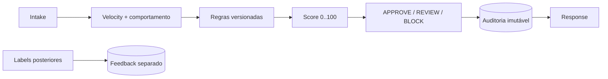

# RiskShield

**v0.1.0 — Real-Time Fraud & Risk Decisioning Foundation**

RiskShield decide risco de pagamentos fictícios em tempo de requisição. Combina regras versionadas, velocity por cliente/device e comportamento individual para retornar **APPROVE, REVIEW ou BLOCK**, com score explicável e auditoria durável. É um projeto de engenharia de risco em Java 21/Spring Boot 4.2, sem frontend.

Uma decisão segue: validação → intenção durável → features temporais/comportamentais → regras → score → policy → auditoria PostgreSQL → resposta. Não há sucesso antes do commit. Redis registra velocity atomicamente; PostgreSQL permite reconciliar contagens após falhas. O domínio não depende de Spring ou infraestrutura.

O diferencial é a semântica da decisão: identidade idempotente, concorrência, event time, atraso, versionamento, explicação e avaliação reproduzível. Não é CRUD de transações e BLOCK não significa fraude comprovada.

Exemplo de explicação: NEW_DEVICE +18, AMOUNT_SPIKE +32 → score 50 → REVIEW na policy baseline-1. A resposta preserva features, regras, thresholds e versões. Configurações passam por maker/checker; candidatas podem rodar em SHADOW sem alterar a decisão ativa. Feedback posterior é separado da decisão original.

### Resultados medidos — exclusivamente sintéticos

Gerador seed **20261121**, **8168 eventos**, **2,9873%** rotulados como fraude pelo gerador. Calibração nas primeiras 24h simuladas; teste nas 16h seguintes (3277 eventos). Positivo = REVIEW ou BLOCK.

| Métrica de teste | Resultado |
|---|---:|
| Precision | 53,3898% |
| Recall | 53,3898% |
| F1 | 0,533898 |
| FPR | 1,7411% |
| FNR | 46,6102% |
| TP / FP / TN / FN | 63 / 55 / 3104 / 55 |

O resultado expõe misses e falsos positivos; não demonstra eficácia em fraude real. AUC não calculada. Thresholds 30/65 escolhidos pelo custo de demonstração na validação; o dataset principal não gerou BLOCK, portanto o corte de bloqueio tem evidência limitada. [Relatório e trade-offs](evaluation/results/evaluation.md), [proveniência](docs/dataset.md), [ML assessment](docs/ml-assessment.md).

Carga local moderada de 15s: steady 21,55 req/s, p50 74,56ms, p95 117,34ms, p99 173,03ms, zero erros. Com 12 clientes: 25,57 req/s, p95 499,89ms. São medições HTTP com autenticação BCrypt e Docker Desktop, não capacidade de produção. [Ambiente e cinco cenários](docs/performance.md).

### Executar no Windows

Requisitos: Docker Desktop Linux engine, PowerShell 7; Java 21 para testes no host.

```powershell
./scripts/dev-up.ps1 -Build
./scripts/smoke.ps1
./scripts/verify.ps1
./scripts/evaluate.ps1 -Seed 20261121
./scripts/load-test.ps1 -Scenario duplicate
./scripts/dev-down.ps1
```

API: http://localhost:28080. Grafana: http://localhost:13000. Credenciais aleatórias são geradas em `.env` ignorado; nunca há senha padrão versionada. Compose usa imagens por digest, app non-root e limites de recursos. Scripts de shutdown preservam volumes e outras aplicações.

| API | Papel |
|---|---|
| POST /risk/evaluations | ENGINE |
| GET /risk/decisions/{id} | ANALYST / AUDITOR |
| GET /risk/reviews?page=0&size=25 | ANALYST |
| POST /risk/feedback | ANALYST |
| POST /risk/admin/configurations | ADMIN maker |
| POST /risk/admin/configurations/{version}/transitions | ADMIN checker |
| POST /risk/admin/evaluation-runs | ADMIN |
| GET /risk/audit/governance ou /risk/audit/shadows | AUDITOR |

Payload usa UUID, IDs `syn_`, amountCents integral, BRL, country, occurredAt UTC em milissegundos e channel WEB/MOBILE/POS; veja [contrato](docs/decisioning.md). Mesmo ID/payload retorna a mesma decisão; payload divergente retorna 409. Redis indisponível força pelo menos REVIEW e indica degradação; falha de auditoria retorna 503. Eventos com mais de 10m de atraso recebem tratamento explícito.

### Arquitetura e provas



Testcontainers usa PostgreSQL/Redis reais. Testes cobrem corridas, falhas, limites temporais, governança, leakage e 10 cenários golden. OpenTelemetry/Tempo, Prometheus e dashboard **RiskShield Overview** permitem observar o caminho. [R1–R36 e evidências](docs/evidence.md), [arquitetura](docs/architecture.md), [threat model](docs/threat-model.md), [ADRs](docs/adr), [versões/fontes](docs/versions.md).

**ML_NOT_INCLUDED_IN_V0.1.0**: nenhum candidato demonstrou ganho mensurado que justifique a complexidade. Kafka também não foi necessário. Sem banco/cliente/cartão real, microserviços artificiais, cloud deployment ou alegação de exactly-once distribuído. Redis standalone; Basic apenas em localhost; dados de auditoria precisam de estratégia operacional de arquivamento antes de uso prolongado. [Limitações de segurança](docs/security.md).

Licença MIT. A foundation v0.1.0 reúne as capacidades e evidências descritas acima; consulte a [Release v0.1.0](https://github.com/GuiNovaisz/riskshield-java-fraud/releases/tag/v0.1.0). v0.2.0 é apenas possibilidade futura de Risk Operations Console, sem implementação nesta entrega.

The complete English version follows below.

## English

RiskShield is a Java 21 / Spring Boot 4.2 portfolio platform for explainable synchronous risk decisions on fictional payments. It combines versioned deterministic rules, customer/device velocity and individual behavioral features to return **APPROVE, REVIEW or BLOCK** with a durable audit. There is no frontend.

The path is validation → durable accepted intent → temporal/behavioral features → rules → score → policy → PostgreSQL audit commit → response. Redis registers attempts atomically; durable intent reconciliation prevents silent undercounts after failures. The domain has no Spring/infrastructure dependency.

The engineering focus is decision semantics: idempotency, concurrency, event time, late events, reproducibility and versioned explanations. BLOCK is a policy outcome, never confirmed fraud. For example, NEW_DEVICE +18 and AMOUNT_SPIKE +32 yield score 50 and REVIEW under baseline-1. Full feature/configuration snapshots survive rule changes. Independent maker/checker governs activation; SHADOW candidates cannot replace active decisions. Delayed labels are append-only and separate.

### Measured synthetic results

Seed **20261121**, **8168 events**, **2.9873%** generator-labeled fraud. First 24 simulated hours calibrate thresholds; next 16 hours form the held-out test (3277 events). Positive means REVIEW or BLOCK.

| Test metric | Result |
|---|---:|
| Precision / recall | 53.3898% / 53.3898% |
| F1 | 0.533898 |
| FPR / FNR | 1.7411% / 46.6102% |
| TP / FP / TN / FN | 63 / 55 / 3104 / 55 |

These results disclose missed fraud and false positives; they do not establish real-world efficacy. AUC is not computed. Validation demo-cost analysis selected thresholds 30/65. The main replay produced no BLOCK outcomes, so the blocking threshold is weakly supported. See [evaluation](evaluation/results/evaluation.md), [dataset](docs/dataset.md), [ML assessment](docs/ml-assessment.md).

Bounded 15-second local steady load measured 21.55 req/s, p50 74.56ms, p95 117.34ms, p99 173.03ms, zero errors. At 12 clients: 25.57 req/s, p95 499.89ms. HTTP measurements include BCrypt and Docker Desktop; these are not production capacity claims. [Five scenarios and environment](docs/performance.md).

### Run and inspect

Docker Desktop Linux engine and PowerShell 7 are required; host verification also needs Java 21. Run the PowerShell commands above. API is on localhost:28080, Grafana on localhost:13000. Random local credentials are generated into ignored `.env`. Images are digest-pinned, application runs non-root, resources are bounded, shutdown preserves volumes and other stacks.

ENGINE submits `/risk/evaluations`; ANALYST reads decisions/review queue and appends feedback; AUDITOR reads decision/governance/shadow evidence; ADMIN creates configurations, transitions versions and records evaluation manifests. Config approval/activation requires a distinct identity from its maker. Use UUID transaction identity, bounded `syn_` identifiers, integral amountCents, BRL, country, millisecond UTC occurredAt and WEB/MOBILE/POS. [API contracts](docs/decisioning.md).

Same identity/payload returns the original decision; conflicting payload returns 409. Redis outage marks degradation and forces at least REVIEW; durable audit failure returns 503. Events more than 10 minutes late are explicitly degraded. Pure domain tests, real PostgreSQL/Redis Testcontainers, exact concurrency proofs, label-flipping evaluation tests and ten frozen golden scenarios support verification. [R1–R36 evidence](docs/evidence.md).

OpenTelemetry/Tempo traces, Prometheus metrics and provisioned **RiskShield Overview** expose the pipeline. See [architecture](docs/architecture.md), [threat model](docs/threat-model.md), [ADRs](docs/adr), [versions](docs/versions.md), [operations](docs/operations.md).

**ML_NOT_INCLUDED_IN_V0.1.0**: no independently measured model benefit justifies inference/governance complexity. Kafka is also omitted. Limitations: synthetic-only data, standalone Redis, localhost-only Basic authentication, trusted database owner, bounded history and no implemented audit archival. No real payment integration, cloud deployment, distributed exactly-once claim or production fraud-loss reduction. MIT license. The v0.1.0 foundation comprises the capabilities and evidence described above; see [Release v0.1.0](https://github.com/GuiNovaisz/riskshield-java-fraud/releases/tag/v0.1.0). A future v0.2.0 Risk Operations Console is only a possibility and is not implemented in this release.
