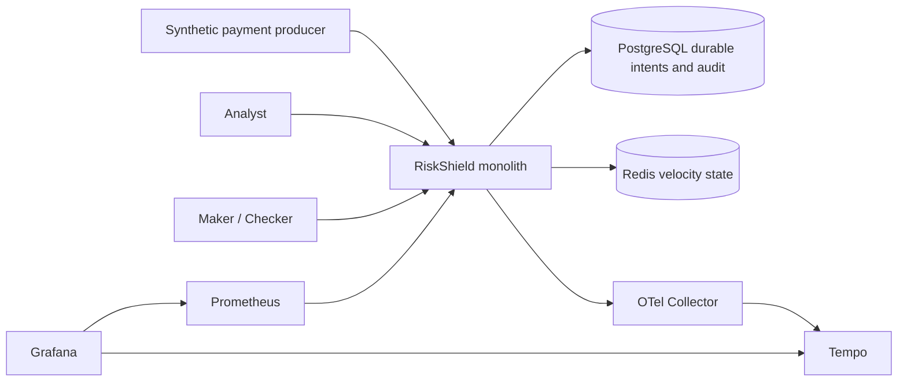
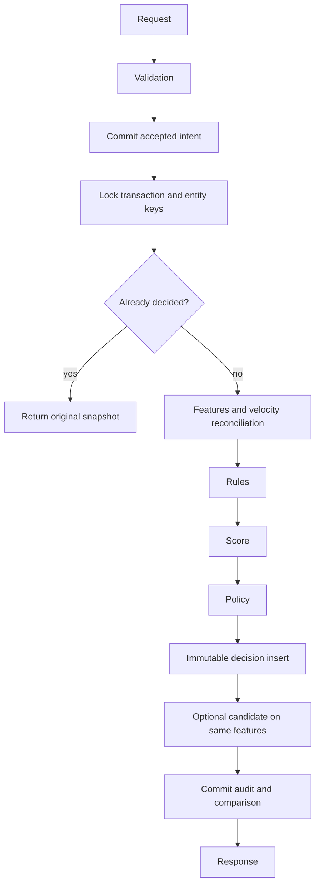

# Architecture

Modular monolith: pure Java `domain`; transactional `application`; Spring/JDBC/Redis/HTTP `adapter`; offline Java `evaluation`. Bounded contexts are decisioning, feature engineering, configuration governance, audit/feedback and evaluation. No frontend, Kafka, ML service or cloud substrate.

Only synchronous durable audit is in the response contract. No distributed exactly-once claim: accepted intents may outlive failed evaluations, Redis registration is idempotent, retries are safe, DB reconciliation prevents undercounts after Redis restart. Per-customer/device database advisory locks coordinate multiple instances. Hash collisions can serialize unrelated entities but cannot weaken invariants. Different entities remain concurrent.

Database failure before commit returns 503, never fictitious approval. HTTP ambiguity after commit is resolved by retrying the same identity. Lock/statement timeouts bound waiting. Runtime retains immutable audit; a separate operational archival policy is required before long-running use.
