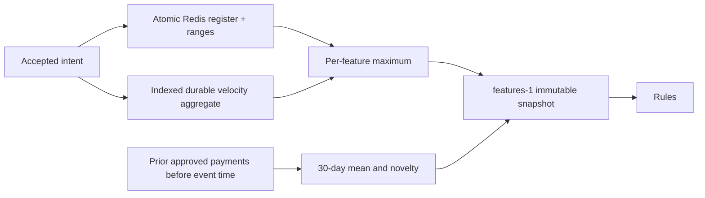

# Feature pipeline

Counts include the current intent, windows are `(t-window,t]`. Features: customer counts 1m/5m/1h, device count 5m, distinct customers/device 1h; prior approved count, new device/merchant/country, personal amount spike, rounded historical mean cents. Exact BigDecimal cross multiplication tests >3x mean without monetary floating point. The rounded mean is explanatory, not the comparator input.

Lineage is `features-1` + bounded approved event history + event-time policy + immutable config. Evaluation and online processing call the same Java behavior implementation and engine. Offline velocity independently implements the documented range definition; boundary integration tests guard drift.
