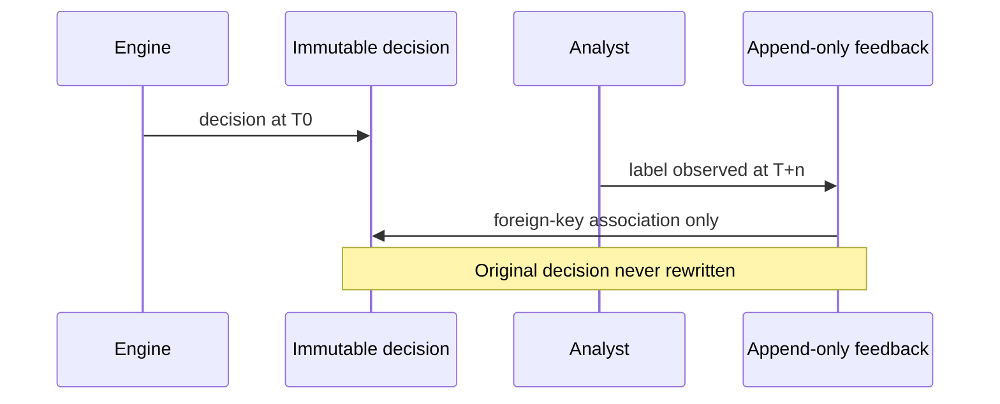

# Feedback and label lifecycle

POST `/risk/feedback`: feedback UUID, decision UUID, label, manual outcome, observedAt, bounded reason. FRAUD ↔ CONFIRMED_FRAUD; LEGITIMATE ↔ LEGITIMATE; UNKNOWN ↔ INCONCLUSIVE. Observation must be no earlier than decision and no later than injected clock. Repeated feedback records are separate audit events; identical feedback UUID conflicts. Actor is authenticated, never assigned from payload.

Feedback table is append-only. Corrections append a new event; consumers must select latest recorded assessment deliberately. The decision domain cannot receive labels and queries do not join feedback into features. Evaluation tests flip every label and future label timestamp while asserting identical features/results.
