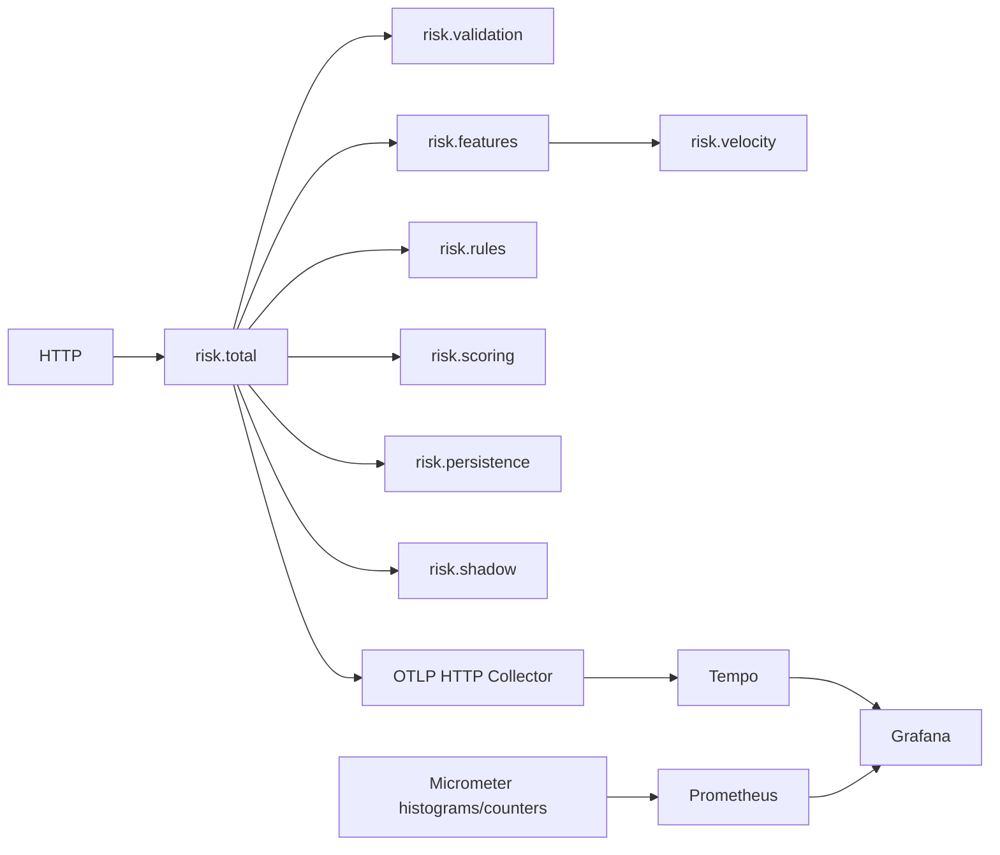

# Observability

OpenTelemetry via Boot starter/Micrometer bridge, sample probability 1 for demo, OTLP HTTP → collector → Tempo gRPC. Structured ECS logs contain service/time/severity and trace correlation; no payloads or tokens. Prometheus pulls 5s. Grafana provisions `RiskShield Overview`, Prometheus and Tempo datasources. No Loki/OpenSearch.

`risk.stage` histogram with fixed `stage`: total/validation/features/velocity/rules/scoring/persistence/shadow. Engine rules include score composition, while the scoring span exposes its output boundary; it does not pretend the tiny accessor is expensive scoring. `risk.decisions` by three outcomes; `risk.rules.fired` by validated bounded reason code; velocity errors, degraded decisions, shadow disagreements, feedback by enum. HTTP framework tags use route templates. No entity identifiers as metric labels.

Ruleset definitions limit 32 rules each, but arbitrary admin-provided reason IDs could accumulate time-series cardinality across versions. Therefore runtime metric labels are normalized to the fixed baseline reason vocabulary plus OTHER. Versions/actors/IDs are audit dimensions, not metric labels.

Alerts are illustrative: latency p95>1s, degraded>10%, velocity errors, 5xx rate>0.1/s, BLOCK rate>50%. They are not production SLO guarantees. Liveness/readiness distinct; readiness ignores Redis and checks DB. Trace persistence and scrape availability are independently checked during evidence collection.
