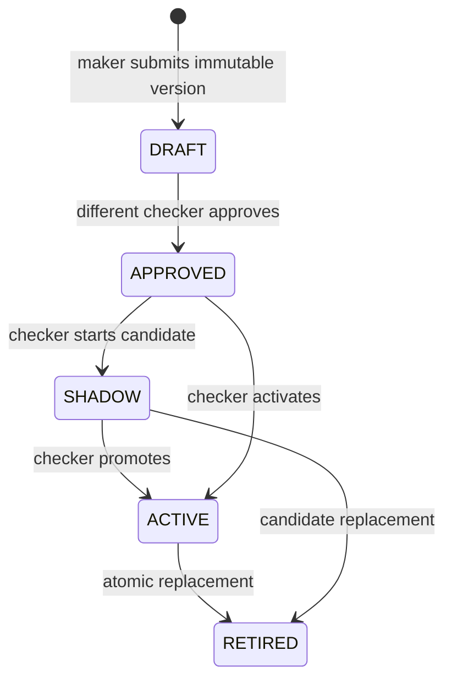

# Rules and stable reason codes

Typed bounded comparator: `feature >= threshold`, enabled flag, priority, description, per-rule version and [effectiveFrom,effectiveUntil). Maximum 32 rules; no arbitrary expression evaluation, scripts, class names or external calls. Duplicate IDs, unknown enum signals, invalid intervals/weights/thresholds are rejected atomically.

| Reason | Signal | Threshold | Contribution |
|---|---|---|---|
| NEW_DEVICE | Device not present in prior approved history | 1 | +18 |
| NEW_MERCHANT | Existing history but merchant absent | 1 | +8 |
| NEW_COUNTRY | Existing history but country absent | 1 | +12 |
| AMOUNT_SPIKE | At least 5 prior approvals and amount > 3x exact mean | 1 | +32 |
| VELOCITY_SPIKE | Customer accepted attempts / 1m | 6 | +35 |
| SUSTAINED_VELOCITY | Customer accepted attempts / 5m | 12 | +20 |
| DEVICE_SHARING | Distinct customers on device / 1h | 4 | +35 |

No impossible-travel or IP-risk claim: input has country, no coordinates or trustworthy geolocation. Reason codes are limited by the typed signal model and remain auditable after revisions.

Policy and rules are one immutable configuration bundle. This deliberately prevents separately inconsistent activation. Every sensitive transition records actor, action, version, before/after, reason and UTC time. Bootstrap baseline is source-reviewed; subsequent changes require independent maker/checker.
